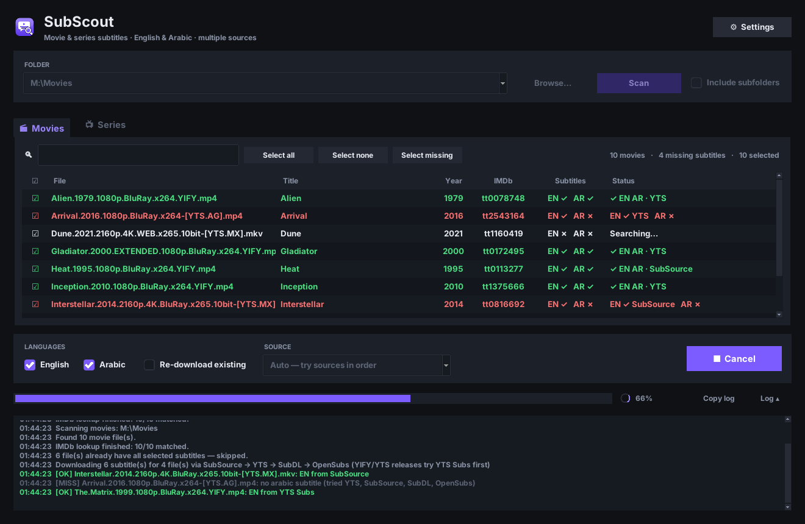

<p align="center">
  
</p>

<h1 align="center">SubScout</h1>

<p align="center">
  <b>English &amp; Arabic subtitles for your whole movie and TV-series library.</b><br>
  Scans your folders and downloads only the missing subtitles, from several subtitle sites, in one click.
</p>

<p align="center">
  <a href="../../releases/latest"></a>
  <a href="../../releases/latest"></a>
  
  <a href="../../stargazers"></a>
</p>

<p align="center">
  <a href="https://github.com/ilukezippo/SubScout/releases/latest/download/SubScout.exe"></a>
</p>

<p align="center">
  
</p>

<p align="center">
  <sub>Downloads the latest <b>SubScout.exe</b> straight away: one file, no Python, no install.</sub>
</p>

<p align="center">
  <a href="../../releases/latest">All downloads</a> ·
  <a href="#what-it-does">Features</a> ·
  <a href="#subtitle-sources">Sources</a> ·
  <a href="#how-to-use">How to use</a> ·
  <a href="#download">Build from source</a>
</p>

---

## What it does

Point SubScout at a movie folder or a TV-series folder. It scans every video, works out the title, year and IMDb ID, and downloads the missing subtitles next to each file as `Movie.en.srt` / `Movie.ar.srt`.

- **Only downloads what's missing.** It checks the disk first, so files that already have their subtitles never touch the network. Existing `.en` / `.eng` / `.english` and `.ar` / `.ara` / `.arabic` subtitles are all recognised.
- **Several subtitle sources with automatic fallback.** In **Auto** mode it tries your sources in order until one has the subtitle, or you can pick a single source.
- **Built around rate limits.** It reads each site's rate-limit headers and slows down *before* hitting them. If a source is paused, it moves on to the next one, then retries the skipped items in a second pass.
- **Smart for YIFY / YTS releases.** Those try YTS Subs first: no quota, and the subtitles are timed for that exact release.
- **Season packs handled.** It picks the right episode's file out of a season ZIP, and never mixes up `E01` with `E10`.
- **Arabic just works.** Old Windows-1256 subtitles are converted to UTF-8, so every player shows them correctly.
- **Movies or series.** Movies can sit in subfolders (`Movie (2010)/movie.mkv`). Series are read as `Show/Season N/Show.S01E02.mkv`; loose episodes in the show folder work too.
- **Select all / none / missing**, a live filter, sortable columns, and a per-file subtitle status (`EN ✓ AR ✗`).
- **Modern UI with dark & white themes.** Dark or White: six accent colours and four backgrounds (Midnight, OLED Black, Slate, White), Segoe UI Bold throughout, a resizable log with *Copy log*, and Windows sounds when a job finishes or something fails.
- **Keeps itself up to date.** It checks GitHub for a new version when it starts; *Update now* downloads the new exe, swaps it in and restarts.

## Subtitle sources

| Source | Movies | Series | Needs |
|---|:---:|:---:|---|
| **YTS Subs** | ✓ | | nothing (uses the IMDb ID) |
| **SubDL (API)** | ✓ | ✓ | free API key — [subdl.com/panel/api](https://subdl.com/panel/api) |
| **SubSource** | ✓ | ✓ | free API key — [subsource.net/dashboard/api](https://subsource.net/dashboard/api) · large Arabic library |
| **OpenSubtitles** | ✓ | ✓ | free API key — [opensubtitles.com/consumers](https://www.opensubtitles.com/en/consumers) · 5 downloads/day, 20 with a free login |
| **SubDL (website)** | | ✓ | nothing (scraper, needs `cloudscraper`) |
| **Gestdown (Addic7ed)** | | ✓ | nothing · mostly English |

Open **⚙ Settings → Sources** to switch sources on or off, change their order, paste your keys and press **Test** / **Test login** to check them.

## Download

Use the **Download for Windows** button at the top, or grab `SubScout.exe` from [all releases](../../releases/latest). It's a single file that runs on any Windows 10/11 PC, with no Python and no install needed.

> The first time you run it, Windows may show *"Windows protected your PC"* because the exe isn't code-signed. Click **More info → Run anyway**.

<details>
<summary>Run from source / build the exe yourself</summary>

```bat
pip install -r requirements.txt
pythonw SubScout.pyw
```

Build the exe the same way the release does:

```bat
pip install pyinstaller
python packaging\make_version_info.py
pyinstaller --onefile --windowed --name SubScout --icon assets\SubScout.ico --version-file packaging\version_info.txt --collect-data cloudscraper --collect-submodules keyring --hidden-import keyring.backends.Windows SubScout.pyw
```

Every push to `main` that changes the app is built automatically by GitHub Actions (`.github/workflows/build.yml`). The result is published as the release for the `APP_VERSION` set in `SubScout.pyw`.
</details>

## How to use

1. Choose the **Movies** or **Series** tab, then **Browse…** to your folder and press **Scan**.
2. SubScout finds the IMDb ID for every title. Wrong match? Right-click the row → *Assign IMDb ID…* (paste an IMDb link) or *Look up IMDb ID again*.
3. Tick the languages, choose **Auto** (or a single source) and press **⬇ Download Subtitles**.
4. Green rows are complete, amber rows are partly done, and red rows mean the last attempt found nothing.

## Where things are stored

| What | Where |
|---|---|
| Settings, source order, API keys, theme | `%LOCALAPPDATA%\SubScout\settings.json` |
| OpenSubtitles password | Windows Credential Manager |
| IMDb matches (per folder) | `.yify_imdb_map.json` inside each scanned folder, so re-scans are instant |
| Crash details | `%LOCALAPPDATA%\SubScout\crash_report.txt` |

## Support

If SubScout saves you time, you can [buy me a coffee](https://buymeacoffee.com/ilukezippo) ☕

Made by **[ilukezippo](https://github.com/ilukezippo)**.
